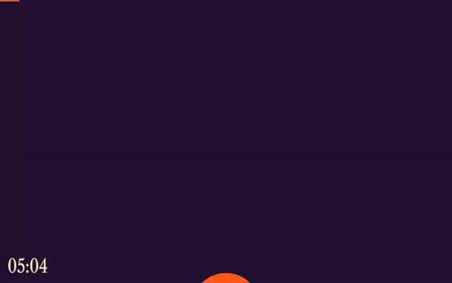

# Poente

**Houses by their light.** Poente adalah website agensi properti fiktif di Lisbon dan Porto yang menjual rumah berdasarkan cahaya yang masuk ke dalamnya, bukan luas lantai. "Poente" adalah kata Portugis untuk arah matahari terbenam, yang di sana dipakai di iklan rumah untuk menyebut sisi barat. Satu halaman berjalan seperti satu hari: warna dan jam di header bergerak dari fajar lilac, siang lemon, sore aprikot, sampai malam aubergine. Ini rebuild orisinal yang mengambil peta halaman dan mekanik interaksi sebuah situs referensi, dengan konsep, palet, tipografi, teks, gambar, dan kode yang seluruhnya baru.

## Halaman

| File | Isi |
|---|---|
| `index.html` | Home: hero satu rumah empat jam, tabel matahari Desember, simulasi cahaya, rumah pilihan, jam matahari, ring foto, fase bulan |
| `homes.html` | Sepuluh rumah dalam tampilan Grid, List, atau Gallery, dengan filter Morning / Midday / Evening |
| `homes/meridiano.html` | Casa do Meridiano, Comporta |
| `homes/janelas.html` | Nove Janelas, Alfama |
| `homes/patio.html` | Pátio Azul, Évora |
| `homes/farol.html` | Farol Velho, Cabo da Roca |
| `homes/nevoa.html` | Quinta da Névoa, Sintra |
| `homes/armazem.html` | Armazém 14, Marvila |
| `homes/basalto.html` | Casa Basalto, Pico |
| `homes/torre.html` | Torre do Douro, Pinhão |
| `homes/ribeira.html` | Ribeira Doze, Porto |
| `homes/salina.html` | Casa da Salina, Olhão |
| `about.html` | Tim, hari kerja, dan aturan agensi |
| `contact.html` | Kontak dan pemilih jam kunjungan (membuka aplikasi email) |
| `legal.html` | Catatan hukum dengan daftar isi sticky |
| `404.html` | Halaman tidak ditemukan |

## Fitur dan interaksi

- **Loader**: jam berjalan 05:00 sampai 06:40, matahari terbit lalu membuka hero (sekali per sesi tab).
- **Drag the sun**: geser matahari di hero untuk mengubah jam; empat foto rumah yang sama bertumpuk (mouse, sentuh, keyboard).
- **Mesin hari**: warna latar, warna teks, dan jam header mengikuti `data-hour` tiap section.
- **Simulasi cahaya** (`js/light.js`): posisi matahari dihitung dari lintang, tanggal, dan jam; setiap jendela diproyeksikan ke lantai dan dinding. Dipakai di home, di "Light plan" tiap rumah (bulan + jam), dan di form kontak.
- **Diagram lintasan matahari**, **jam matahari pinned** dengan jari-jari yang melengkung mengikuti kecepatan scroll, **ring foto** yang naik, mengitari teks, lalu bergeser ke samping untuk statistik, dan **14 fase bulan**.
- **Homes**: satu set gambar berpindah antar Grid / List / Gallery; Gallery adalah bidang tak berujung yang bisa di-drag, wheel, atau panah keyboard; hover meredupkan rumah lain.
- **Halaman rumah**: galeri Detail / Masonry / Slider dengan transisi FLIP, jam terbaik dan terburuk, rumah berikutnya.
- **Transisi halaman** berbentuk cakram matahari, wordmark footer dengan huruf O sebagai matahari yang tenggelam.
- Smooth scroll hanya untuk wheel mouse; sentuh, keyboard, scrollbar, dan `scrollTo` tetap native. `prefers-reduced-motion` dihormati. Responsif 390 px sampai desktop.
- Tanpa sound (situs acuan juga tidak memakainya).

### Kualitas scroll (hasil uji)

Diuji otomatis dengan scroll sungguhan (wheel, flick, balik arah, keyboard, sentuh) pada satu halaman per template di 1440x900 dan 390x844. Semua lolos: 58,8 sampai 60 fps, skrip per frame p95 paling tinggi 3,9 ms, tanpa lompatan atau gerak mundur, scene pinned bergeser 0 px, tinggi halaman tidak berubah saat discroll. Angka berasal dari Chromium headless di satu mesin, bukan dari ponsel fisik.

## Teknologi

HTML, CSS, dan JavaScript native. Tanpa framework, tanpa build, tanpa request pihak ketiga. Font disimpan lokal: **Libre Caslon Condensed** (display) dan **Host Grotesk** (teks).

## Menjalankan

Buka `index.html` langsung di browser.

## Struktur

```
.
├── index.html  homes.html  about.html  contact.html  legal.html  404.html
├── homes/                 10 halaman rumah
├── css/style.css          semua gaya dan token
├── js/
│   ├── app.js             mesin hari, scroll, loader, transisi, section home
│   ├── light.js           posisi matahari, gambar ruang, diagram lintasan
│   ├── homes.js           Grid / List / Gallery + filter
│   ├── house.js           light plan + galeri halaman rumah
│   ├── contact.js         pemilih jam
│   └── legal.js           daftar isi aktif
├── assets/
│   ├── img/               93 gambar (s/ = versi kecil untuk grid dan ring)
│   ├── fonts/             3 file woff2
│   └── favicon.svg
├── docs/preview/          homepage.gif, hero.png
└── README.md
```

## Mengedit

Edit langsung di file HTML/CSS/JS; tidak ada generator.

- **Teks**: di HTML masing-masing. Header dan footer berulang di setiap halaman.
- **Warna**: malam, krem, matahari, dan sinar ada di `:root` pada `css/style.css`. Palet hari ada di array `DAY` pada `js/app.js`; jam tiap section ada di atribut `data-hour`. Warna awal halaman ada di atribut `style` pada `<html>`.
- **Rumah**: `data-cfg` pada section `.lp` (dan `<option>` di `contact.html`) berisi lintang, arah hadap (derajat dari utara), serta jumlah jendela. Angka jam matahari di teks adalah hasil hitung dari nilai itu, jadi ubah keduanya bersama.
- **Gambar**: ganti file dengan nama sama di `assets/img/` dan `assets/img/s/`. Pola rumah: `<slug>-1` cover 16:9, `-2` dan `-4` 4:3, `-3` dan `-5` 3:4, `-6` malam 16:9.

## Placeholder yang perlu diganti

Nama brand dan tagline, email `@poente.example`, nomor `+351 21 000 00 0x`, alamat Rua da Bica 00 dan Rua das Flores 00, lisensi `AMI 00000`, nama tim, angka statistik (28, 640, 12, 3), harga, luas, dan cerita rumah, tautan Instagram dan Pinterest, serta teks `legal.html`.

## Kredit

- Gambar: dihasilkan AI (Nano Banana via Google Flow). Orang dan bangunan di dalamnya tidak nyata.
- Font: Libre Caslon Condensed dan Host Grotesk, Google Fonts, SIL Open Font License.

## Keterbatasan

- Simulasi cahaya memakai ruang sederhana 7 x 6 m dan waktu matahari (solar time); pohon, bangunan tetangga, dan tebal dinding tidak dihitung.
- Foto satu rumah dibuat dengan prompt terpisah, jadi detail bangunan bisa sedikit berbeda antar foto. Hero empat jam dibuat dari satu foto acuan.
- Bukan salinan 1:1 dari situs acuan: konsep, palet, dan tipografi memang diganti. Efek WebGL situs acuan didekati dengan CSS dan canvas 2D.
- Total gambar sekitar 63 MB (dimuat lazy); untuk produksi sebaiknya dikonversi ke AVIF atau WebP.
